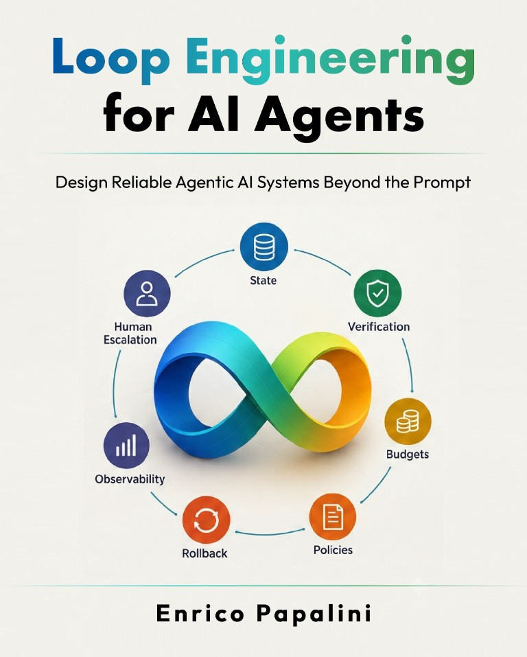

# Loop Engineering for AI Agents

<p align="center">
  
</p>

Companion repository for *Loop Engineering for AI Agents* by Enrico Papalini,
published by Packt. Loop engineering turns objectives into bounded, verifiable
work: select a task, supply context, act, check, retain state, and decide whether
to continue, stop, or ask a human.

**[Start here: install and run the companion](docs/guides/getting-started.md).**
The offline examples require Python 3.10+ and use only the standard library.
The optional local-model workflow obtains model weights and native binaries
separately; no sibling repository is required.

## Find material by chapter

| Chapter | Companion material |
| --- | --- |
| 1 — Foundations and critical assessment | [Contract walkthrough](docs/chapters/chapter-1.md) · [Figures](imgs/cph1/) · [Listing 001](Code/listing_001.txt) · [Equations](Equations/equation_1_1.tex) · [Governance templates](examples/governance/) |
| 2 — The organization becomes a loop | [Ownership walkthrough](docs/chapters/chapter-2.md) · [Figures](imgs/cph3/) · [Equation](Equations/equation_2_1.tex) · [Ownership templates](examples/governance/) |
| 3 — Economics of loop engineering | [Economic models and worked case](docs/chapters/chapter-3.md) · [Figures](imgs/cph4/) · [Equations](Equations/equation_3_1.tex) |
| 4 — The Ralph loop | [Controller guide](docs/chapters/chapter-4.md) · [Figures](imgs/cph2/) · [Listings 002–019](Code/) |
| 5 — Building a full local AI loop | [Control policies](docs/chapters/chapter-5.md) · [Kowalski Loop — full stack](https://github.com/popoloni/kowalski_loop) · [Local-model guide](docs/guides/local-model.md) · [Figures](imgs/cph5/) · [Equations](Equations/equation_5_1.tex) · [Listings 020–041](Code/) |
| 6 — Choosing the right loop | [Mechanisms and use cases](docs/chapters/chapter-6.md) · [Figures](imgs/cph6/) · [Equations](Equations/equation_6_1.tex) · [Listings 042–060](Code/) |

## Repository map

Chapter 5's full local stack is developed in **[Kowalski Loop](https://github.com/popoloni/kowalski_loop)**,
by the same author, Enrico Papalini. This companion provides smaller teaching
examples; see the [chapter 5 guide](docs/chapters/chapter-5.md) for the relationship
and installation links.

| Location | Purpose |
| --- | --- |
| [loopeng/](loopeng/) | Canonical Python implementation, organized by domain; run `python -m loopeng` |
| [examples/](examples/) | Editable scenarios, task inputs, prompts and governance worksheets |
| [tests/](tests/) and [scripts/](scripts/) | Focused tests and the offline integration gate |
| [docs/](docs/README.md) | Guides, chapter explanations, reference maps and validation evidence |
| [Code/](Code/), [Equations/](Equations/), [imgs/](imgs/) | Original numbered book assets with stable publisher-facing filenames |
| [BIBLIOGRAPHY.md](BIBLIOGRAPHY.md) | Clickable citations in manuscript chapter order |

The book's working title was *Non-Deterministic Loop Engineering*. Historical
asset names and figure folders retain that convention; the [asset map](docs/reference/assets.md)
explains their chapter mapping. Numbered listings include pseudocode, shell
fragments, JSON and excerpts: read them alongside the book, not as one application.

## Check the companion

From the repository root:

```bash
python3 -B scripts/check.py
```

This runs unit tests, duplicate-file detection, local documentation link checks, the asset inventory and
canonical offline demos without installing packages or downloading artifacts.
Live-model runs are separate; see the [refactor validation and limits](docs/validation/refactor.md).
A fixture pass does not establish production readiness or human authorization.

## Attribution and contributions

Chapter 6 draws on Fareed Khan's independent
[*Agentic Loop Engineering: Executed and Measured* course](https://github.com/FareedKhan-dev/agentic-loop-engineering-course).
Its notebooks, datasets, results and runtime are not bundled. See
[relationship and attribution](docs/reference/course-relationship.md) and the
[coverage audit](docs/reference/coverage.md) for evidence boundaries.

See [CONTRIBUTING.md](CONTRIBUTING.md) for architecture, ownership and checks.
The repository contains an [Apache License 2.0](LICENSE); possession of these
assets does not grant a license to reproduce the full book. Packt publishes the
book and does not maintain the independent course.
